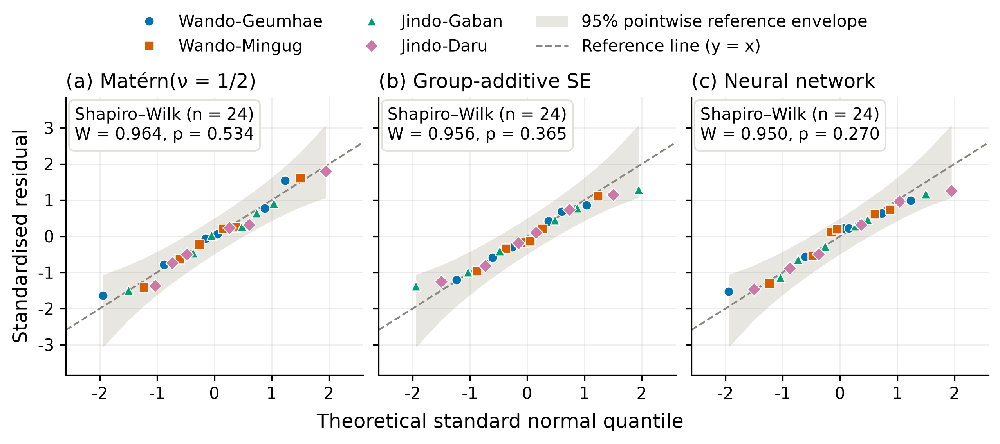
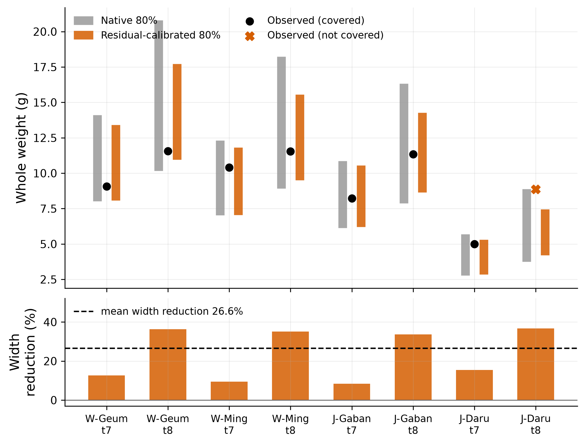
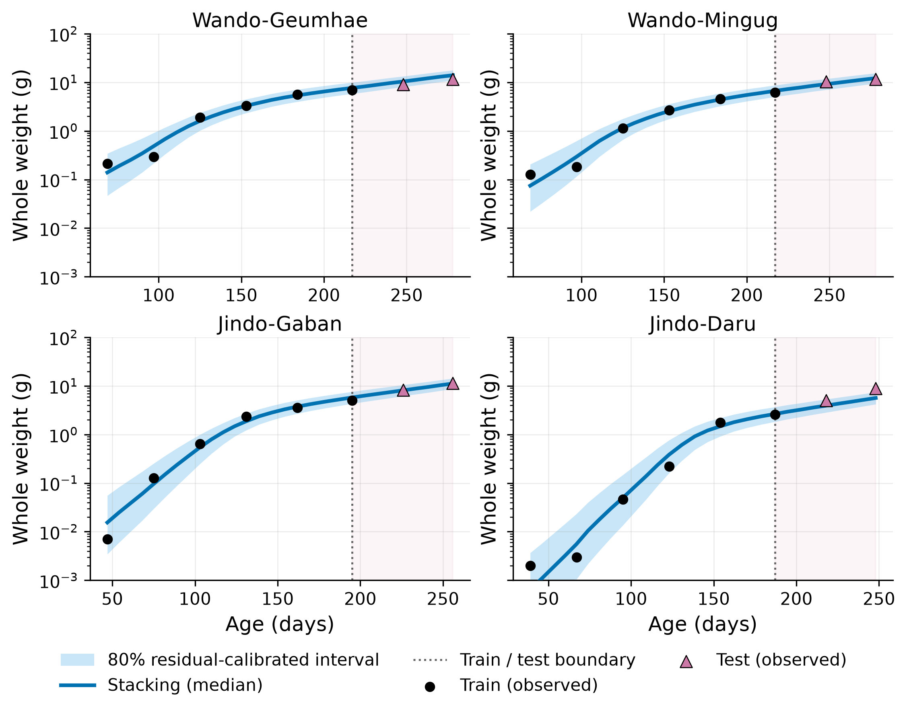

# Nursery Growth Prediction of Pacific Abalone

Analysis code and reported outputs for **“Nursery Growth Prediction of Pacific Abalone Using Stacked Monotone Gaussian Processes with Residual-Calibrated Prediction Intervals.”**

The analysis combines three monotonicity-constrained Gaussian process (GP) predictive distributions—a Matérn(ν = 1/2) kernel, a group-additive squared-exponential (SE) kernel and a neural-network kernel—using leave-one-out (LOO) predictive-density stacking. The default point prediction is the median of the stacked predictive mixture. The reported 80% interval is centered on that median and calibrated from LOO residual scores.

## Repository contents

| Path | Contents |
|---|---|
| `abalone_median.py` | Complete analysis and reproduction script |
| `reproduce_all.py` | Regenerates Figures 1–6, Tables 1–5 and the Section 3 values and compares them with the published values |
| `scripts/figures/`, `scripts/tables/`, `scripts/text/` | One entry point per manuscript figure and table, and one for the Section 3 values |
| `scripts/paper_outputs.py`, `scripts/eda_common.py` | Shared runners behind the entry points |
| `results/figures/`, `results/tables/` | Figures 1–6 (PDF and 300-dpi PNG) and Tables 1–5 (CSV) |
| `results/text/` | Numbers quoted in the Results text, Section 3 (CSV) |
| `results/manifest.csv`, `results/validation/` | File checksums and sources; verification records |
| `docs/FIGURE_PROVENANCE.md` | Source function and input of every figure and table |
| `docs/REPRODUCIBILITY.md` | Environment, run behavior, and numerical reproducibility notes |
| `input_data/` | Synthetic example workbooks; `input_data/README.md` lists workbook locations and required columns |

## Quick start

Python 3.12 is recommended; `environment.yml` pins Python 3.12.16 and the package versions of the release run (Windows x86_64; see [`docs/REPRODUCIBILITY.md`](docs/REPRODUCIBILITY.md)).

```bash
git clone https://github.com/DongHwan-K/abalone-growth-gp.git
cd abalone-growth-gp
conda env create -f environment.yml
conda activate abalone-growth-gp
```

Run the complete analysis on the synthetic example workbooks and generate Figures 1–6, Tables 1–5 and the Section 3 values, followed by verification and the manifest:

```bash
python reproduce_all.py --example --workers 3
```

With the original research data, a full run makes 354 GP fits, three machine-learning comparisons, and facility-specific von Bertalanffy and Gompertz fits; on the reference machine it takes about 25 minutes with three workers. Fits are checkpointed, so interrupted runs resume and later runs compute only missing fits (see [Checkpoints](#checkpoints)).

## Generate individual figures and tables

Each figure and table, and the Section 3 values, has its own entry point. Run the following commands from the repository root. By default they write to the paths shown.

| Output | Command | Result |
|---|---|---|
| Figure 1 | `python scripts/figures/Figure1.py` | `results/figures/Figure1_environmental_variables_by_site.{pdf,png}` |
| Figure 2 | `python scripts/figures/Figure2.py` | `results/figures/Figure2_correlation_heatmap_logweight_environment.{pdf,png}` |
| Figure 3 | `python scripts/figures/Figure3.py` | `results/figures/Figure3_monthly_log_weight_distributions.{pdf,png}` |
| Figure 4 | `python scripts/figures/Figure4.py` | `results/figures/Figure4_residual_qq.{pdf,png}` |
| Figure 5 | `python scripts/figures/Figure5.py` | `results/figures/Figure5_intervals_p80.{pdf,png}` |
| Figure 6 | `python scripts/figures/Figure6.py` | `results/figures/Figure6_growth_curves_shared_p80.{pdf,png}` |
| Table 1 | `python scripts/tables/Table1.py` | `results/tables/Table1_facilities.csv` |
| Table 2 | `python scripts/tables/Table2.py` | `results/tables/Table2_component_gp.csv` |
| Table 3 | `python scripts/tables/Table3.py` | `results/tables/Table3_comparators.csv` |
| Table 4 | `python scripts/tables/Table4.py` | `results/tables/Table4_kernel_ablation.csv` |
| Table 5 | `python scripts/tables/Table5.py` | `results/tables/Table5_framework_variants.csv` |
| Section 3 values | `python scripts/text/Section3.py` | `results/text/Section3_values.csv` |

Figures 1–3 accept `--data`, `--sheet` and `--output-dir`. Figures 4–6, Tables 1–5 and the Section 3 values accept `--data`, `--work-dir`, `--output-dir` and `--workers`. When using the bundled synthetic workbooks, pass a separate `--output-dir` so the released results are not overwritten and, for model outputs, a separate `--work-dir` for their fits and checkpoints:

```bash
python scripts/figures/Figure1.py --data "input_data/전복 4개세트통합데이터.xlsx" --sheet dataset_d_spat_2024 --output-dir abalone_paper_results/example_manual/figures
python scripts/tables/Table1.py --data "input_data/전복데이터.xlsx" --work-dir abalone_paper_results/example_manual --output-dir abalone_paper_results/example_manual/tables
```

`reproduce_all.py --example` sets these folders automatically.

### Checkpoints

Fits are read from `abalone_paper_results/_checkpoints_S2000/`, the folder `abalone_median.py` itself writes (another location can be given with `--work-dir`). With `--example`, results and checkpoints are stored under `abalone_paper_results/example/<key>/`, where the key identifies the inputs and recorded environment. Only missing fits are computed and appended; checkpoints are never deleted and are not part of the repository or the release ZIP.

Figures 1–3 and Table 1 fit nothing; Figures 4–6 and Tables 2–4 use the base GP fits; Table 5 and the Section 3 values also use the ablation fits. `reproduce_all.py` reads each fit once and shares it across all outputs; with complete checkpoints the whole run takes under a minute.

### Verification

Without `--example`, `reproduce_all.py` writes `results/manifest.csv` (SHA-256, script and source function of every file) and the verification records in `results/validation/`. `results/validation/manuscript_comparison.csv` compares every number printed in Tables 1–5 and Figures 2, 4 and 5 with the regenerated value at the printed precision. Intermediate files under the script's internal names are kept in `abalone_paper_results/point_median/`; additional unnumbered diagnostic outputs of `abalone_median.py` are not included in `results/`.

- **Without `--example`**, `python reproduce_all.py --workers 3` writes to `results/` and exits with status 1 if any compared value differs. This mode requires the original research workbooks; with the bundled synthetic workbooks it reports mismatches.
- **With `--example`**, the numbered outputs, manifest and verification records are written below `abalone_paper_results/example/<key>/results/`. Input alignment, figures, tables and the separate-process entry points are checked. Differences from the published values are recorded for information only; required-input or internal-consistency failures cause a nonzero exit status.

## Data

The original research workbooks are not distributed. To request access to the raw Pacific abalone data used in this study, please contact the corresponding author. The figures, tables and values in `results/` and in [Results](#results) were generated from the original research data.

The two example workbooks in `input_data/` contain synthetic records that demonstrate the input format and execution workflow; their values were generated independently of the original observations. Other spreadsheets are excluded by `.gitignore`.

| Workbook | Rows | Used for |
|---|---|---|
| `input_data/전복데이터.xlsx` | 32 facility-date rows | Figures 4–6, Tables 1–5, Section 3 values |
| `input_data/전복 4개세트통합데이터.xlsx`, sheet `dataset_d_spat_2024` | 960 individual measurements | Figures 1–3 |

The analysis follows the study design: 2024 observations from four nursery facilities, with six training occasions and two test occasions per facility. Inputs must use the year, measurement occasions and facility labels described in [`input_data/README.md`](input_data/README.md), which also contains the data-handling note. In the example workbooks, measurements fall on the last day of each month from April to November 2024, and the stocking date is 1 April 2024.

Each row of the analysis workbook is the arithmetic mean wet weight of one facility on one date, before the response transformations are applied. Required columns:

| Column | Meaning |
|---|---|
| `로그무게` | Log of the facility-date arithmetic mean weight |
| `전중(g)` | Arithmetic mean total wet weight in grams |
| `품종` | Facility/cohort identifier |
| `측정일` | Measurement date |
| `일령` | Age in days |
| `월평균PH` | Monthly mean pH |
| `월평균염분` | Monthly mean salinity |
| `월평균DO` | Monthly mean dissolved oxygen |
| `월평균수온` | Monthly mean water temperature |

Figures 1–3 use the individual measurements, with columns `날짜`, `품종`, `전중(g)`, `수온`, `DO`, `PH` and `염분`.

## Results

Results from the original research data:

| Quantity | Result |
|---|---:|
| Matérn(ν = 1/2) stacking weight | 0.1565 |
| Group-additive SE stacking weight | 0.4361 |
| Neural-network stacking weight | 0.4074 |
| Stacked RMSE | 1.6363 g |
| Stacked MAE | 1.2852 g |
| Stacked MAPE | 14.2875% |
| Predictive R² | 0.9552 |
| Native 80% mean width | 6.5722 g |
| Residual-calibrated 80% mean width | 4.8244 g |
| Width reduction | 26.5947% |
| Native 80% coverage | 8/8 |
| Residual-calibrated 80% coverage | 7/8 |

The Shapiro–Wilk p-values for standardized training residuals were 0.534, 0.365, and 0.270 for the Matérn, group-additive SE, and neural-network GP candidates, respectively.

### Residual normality



### Test prediction intervals



### Facility growth trajectories



## Implementation notes

- Response: arithmetic mean weight → natural log → Yeo–Johnson transformation → standardization.
- Predictive draws include latent-function uncertainty and Gaussian observation noise.
- The native interval is obtained from the 10th and 90th quantiles of the stacked predictive mixture.
- One stacking-weight vector, estimated from all LOO predictive densities, is used for every LOO calibration score.
- Each score is centered on the median of the corresponding LOO mixture distribution.
- The final point prediction, growth-curve line, and residual-calibrated interval center all use the full stacked-mixture median.
- The group-additive kernel uses one outer scale with relative environmental and facility block scales; the age block scale is fixed at one inside the additive kernel.

Some internal function names and output columns use the term `conformal`. The figure labels use **residual-calibrated** because the implementation uses pooled LOO residual scores and is not Jackknife+.

## Reproducibility

All fits use recorded seeds. Exact last-bit agreement depends on the processor, BLAS implementation, PyTorch build, and optimizer tie-breaking. See [`docs/REPRODUCIBILITY.md`](docs/REPRODUCIBILITY.md) before comparing a new run with the included CSV files.

GitHub Actions runs lightweight release checks and then a separate full example-analysis job. The release check (`python scripts/check_release.py`) verifies every released file, including `abalone_median.py` and the example workbooks, against the SHA-256 digests in `SHA256SUMS.txt`. The full job installs Python 3.12.16 and the recorded requirements, validates both Excel inputs, runs the GP fits and all numbered outputs, checks internal consistency and verifies that the released source and results remain unchanged. Its outputs and verification records are available in the `synthetic-example-results` workflow artifact.

## Citation

Please use the repository’s **Cite this repository** menu, generated from [`CITATION.cff`](CITATION.cff).

## License

The code and repository documentation are released under the [MIT License](LICENSE). The original research data are not covered by this software license and are not included.
